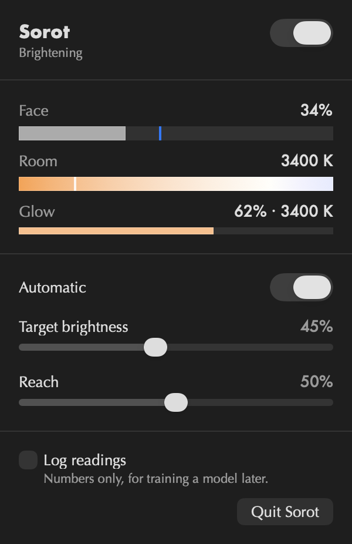

# Sorot

A menu bar app for macOS that turns the edges of your screen into a light for your webcam, and adjusts that light by itself.

It watches your face through the camera, measures how bright it is, and raises or lowers a band of light around the screen until your face reaches the brightness you set. It also estimates the colour of the light in your room and tints the screen light to match, so your face is not lit in two different colours.

*Sorot* is Indonesian for a beam of light.



Status: v0.1, an early prototype. The control loop is rule-based. The trained colour model described under Roadmap does not exist yet.

## How it works

About five times a second:

1. **Capture.** One 640×480 frame from the default camera.
2. **Find the person.** Two of Apple's Vision models run on the frame: a face detector, and a person segmenter that separates you from the room.
3. **Measure.** Average brightness of the middle of your face, the left and right halves separately, and the average colour of the background.
4. **Estimate the room.** The background colour is converted to a colour temperature in kelvin (McCamy's approximation).
5. **Decide.** If your face is darker than the target, the glow goes up; if brighter, down. Inside a small band around the target nothing changes, which stops flicker.
6. **Light.** The band on each screen edge is redrawn. The edge next to the brighter side of your face is dimmed, which evens out side shadows.

In manual mode the camera is off and you set brightness and colour yourself.

## Build

Needs macOS 13 or later and Xcode's command line tools.

```bash
./make-app.sh
open build/Sorot.app
```

The app appears in the menu bar. It starts switched off. The first time you switch it on, macOS asks for camera access.

## Privacy

Frames are analysed in memory on your Mac and then discarded. Nothing is uploaded. "Log readings" is off by default; when on, it writes numbers only (brightness, kelvin, glow level) to `~/Library/Application Support/Sorot/readings.csv`.

The camera's green light stays on while automatic mode is running, because the app is reading the camera.

## Limits

- A screen is a weak light. It helps in a dim room at laptop distance and does very little in daylight.
- The room colour estimate assumes the background averages out to grey, and it is read from frames the camera has already white-balanced. Treat the kelvin number as approximate. A room with an orange wall will read warmer than it is.
- One brightness target does not suit every skin tone. Set "Target brightness" to what looks right for you.
- The light covers the screen edges. "Reach" sets how far in it goes.
- Only the main display is lit.

## Roadmap

- **v0.2** Probe calibration: change the glow by a known amount, watch how the face responds, and use that to separate room light from screen light.
- **v0.3** Train a small model on logged readings to estimate room colour, and replace the grey-background assumption.
- **v1.0** Signed release.

## Licence

MIT. See [LICENSE](LICENSE).
